<div align="center">


# AUSTWise

**The all-in-one campus companion for students of Ahsanullah University of Science & Technology (AUST).**

Routines, grades, question banks, campus maps, budgeting, messaging, a marketplace and a gaming lobby, all in one place and synced across your devices.

[](https://austwise.vercel.app)


[**Live app**](https://austwise.vercel.app) · [Features](#features) · [Screenshots](#screenshots) · [Architecture](#architecture) · [Getting started](#getting-started) · [Deployment](#deployment)

<br />

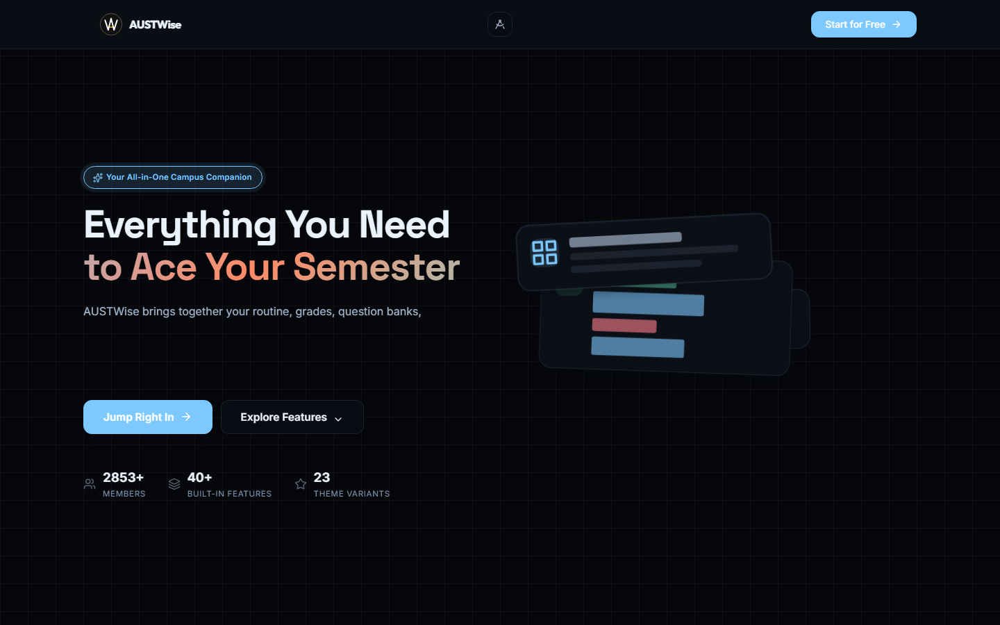

</div>

---

## Why AUSTWise

A typical AUST semester runs on a dozen separate places: a timetable PDF, a CGPA spreadsheet, Facebook groups for past papers, a notebook for expenses, Messenger for classmates. AUSTWise puts all of that in **one installable web app** built around AUST's own departments, semesters, sections, lab groups and campus.

- **Built for AUST.** All 8 departments (CSE, EEE, CE, ME, IPE, TE, ARCH, BBA), the 14-week semester, the real floor plans and AUST's grading scale.
- **Works on every screen.** Sidebar layout on desktop, a bottom tab bar on phones, and installable as a PWA.
- **Synced and real-time.** Your data follows your account to every device. Chat, presence and gaming rooms update live over WebSockets.
- **23 themes**, plus a "Studio" layout mode.

---

## Features

| Area | What it does |
| --- | --- |
| **Dashboard** | Time-aware greeting, study streak, *At a glance* (CGPA, attendance, deadlines, credits), daily routine flow, live deadline countdown, semester view, Zero Hour (quiz/mid/final tracker) and attendance progress. |
| **GradeLab** | CGPA calculator with trend charts, semester-wise grade sheets with templates, department CGPA heatmap, best/worst course poll and an interactive prerequisite flow map. |
| **InsideAUST** | Floor-by-floor campus map (Ground–8th), live library occupancy with GPS check-in, canteen menu with feedback, bus tracker and a free-classroom finder. |
| **Resource Vault** | Notebook, Batch Drive (semester material gated by senior-issued 8-digit codes), Carbon Vault and a code generator for seniors. |
| **Question Bank Analyzer** | Turns past papers, syllabus and slides into a ranked study plan with a guided master prompt. Tracks solved questions, saved analyses and history. |
| **Daily Life** | Cover-page generator (assignments and lab reports, PDF export), *Bhara Koto* fare estimator, **TakaGeloKoi** budget tracker, mess-meal manager, Life Planner (timeline, mindmap, courses heatmap), digital footprint and an encrypted password manager. |
| **Community** | Alumni directory, clubs hub, student directory, faculty directory and mentor requests. |
| **ConnectBox** | Real-time 1-to-1 messaging with unread filters, reactions and online presence. A floating chat head is available on desktop (Electron) and Android. |
| **Productivity** | Pomodoro *Study Time* with ambient sounds and Zen mode, cheat sheets for every department, *Code Pulse* competitive-programming hub and Google Classroom workspace. |
| **Marketplace** | *AW Market* peer-to-peer listings, *ToLet Mama* bachelor housing, and Lost & Found. |
| **Gaming Zone** | Game lobbies for 12 titles, rooms with live chat, squad finder, events and tournament brackets, ranks, and moderation tools. |
| **Shadow** | Anonymous campus forum and 10-minute anonymous match chat. |
| **Admin panel** | Role-based admin for users, notices, canteen, library, academic data, role applications, CR/SR directory, feature flags and question bank. |
| **Plans** | Free and Pro tiers with local payment gateways (SSLCommerz / PipraPay). |

### Roles

Access is role-aware. **Students**, **CRs** (class representatives), **SRs** (senior representatives), **alumni** and **admins** each see the tools that fit them. Features can be toggled per role from the admin panel without a redeploy.

---

## Screenshots

<table>
  <tr>
    <td width="50%">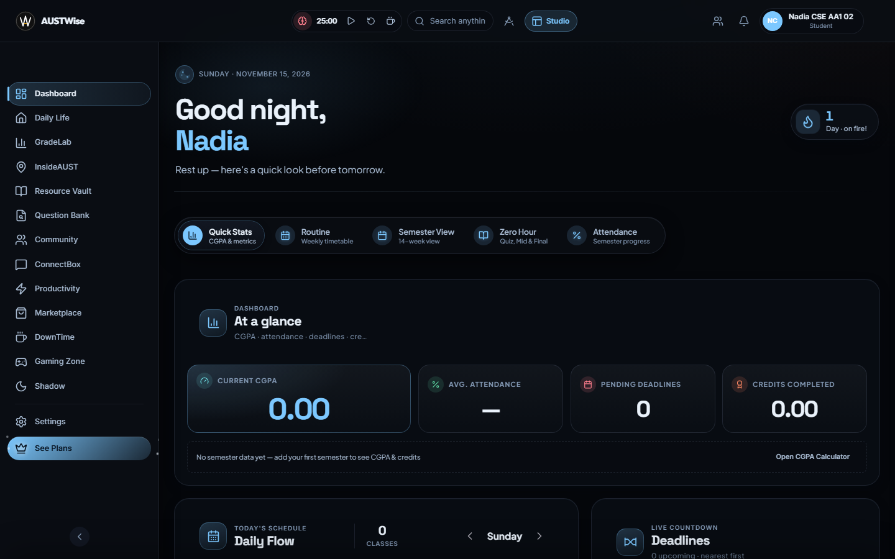<p align="center"><b>Dashboard</b>: today at a glance</p></td>
    <td width="50%">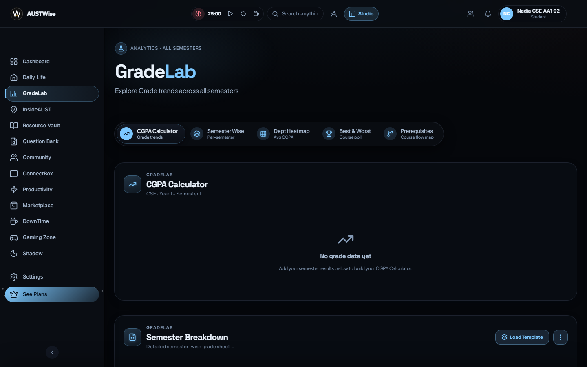<p align="center"><b>GradeLab</b>: CGPA and semester analytics</p></td>
  </tr>
  <tr>
    <td>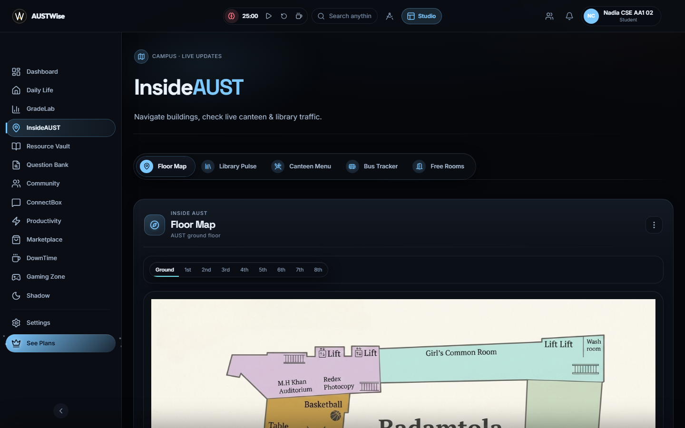<p align="center"><b>InsideAUST</b>: floor maps and live campus data</p></td>
    <td>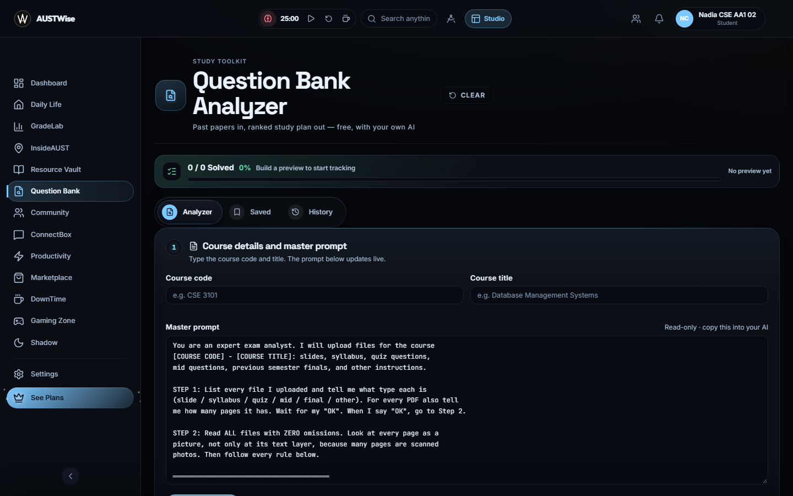<p align="center"><b>Question Bank Analyzer</b>: past papers to study plan</p></td>
  </tr>
  <tr>
    <td>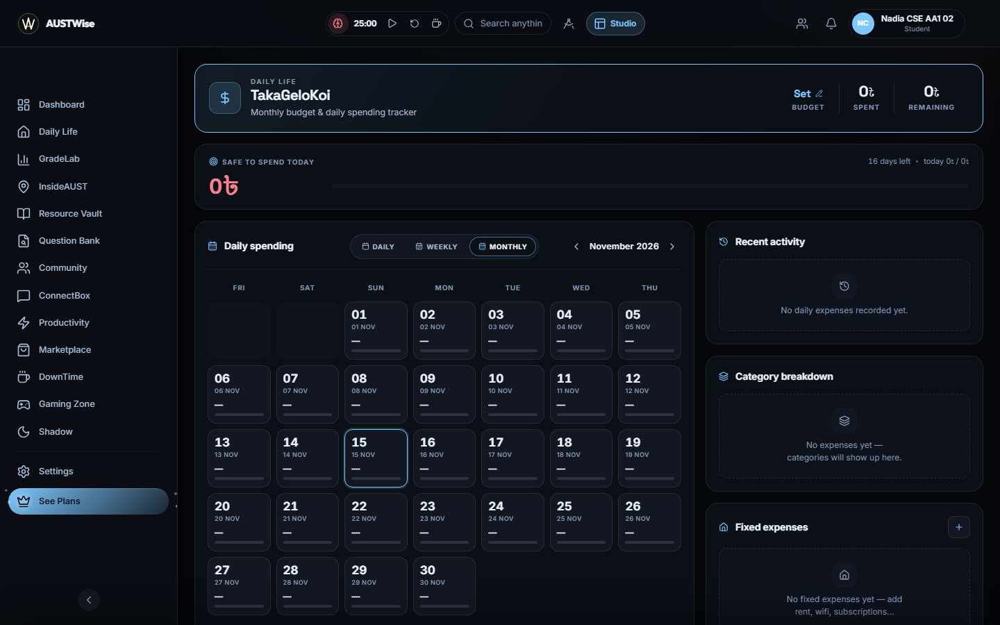<p align="center"><b>TakaGeloKoi</b>: monthly budget and daily spending</p></td>
    <td>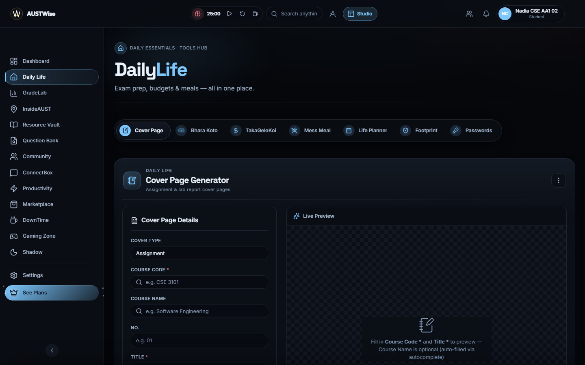<p align="center"><b>Daily Life</b>: cover pages, fares, meals and planner</p></td>
  </tr>
  <tr>
    <td>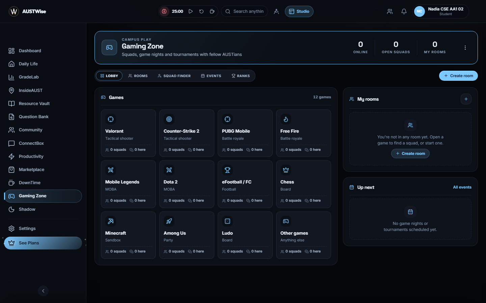<p align="center"><b>Gaming Zone</b>: squads, rooms and tournaments</p></td>
    <td>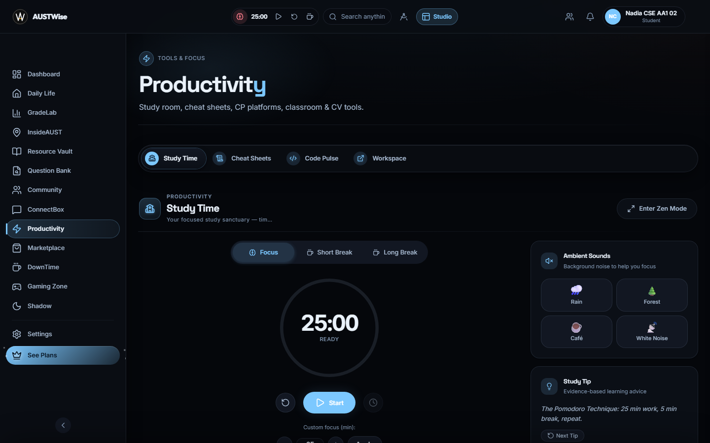<p align="center"><b>Productivity</b>: focus timer and study tools</p></td>
  </tr>
  <tr>
    <td>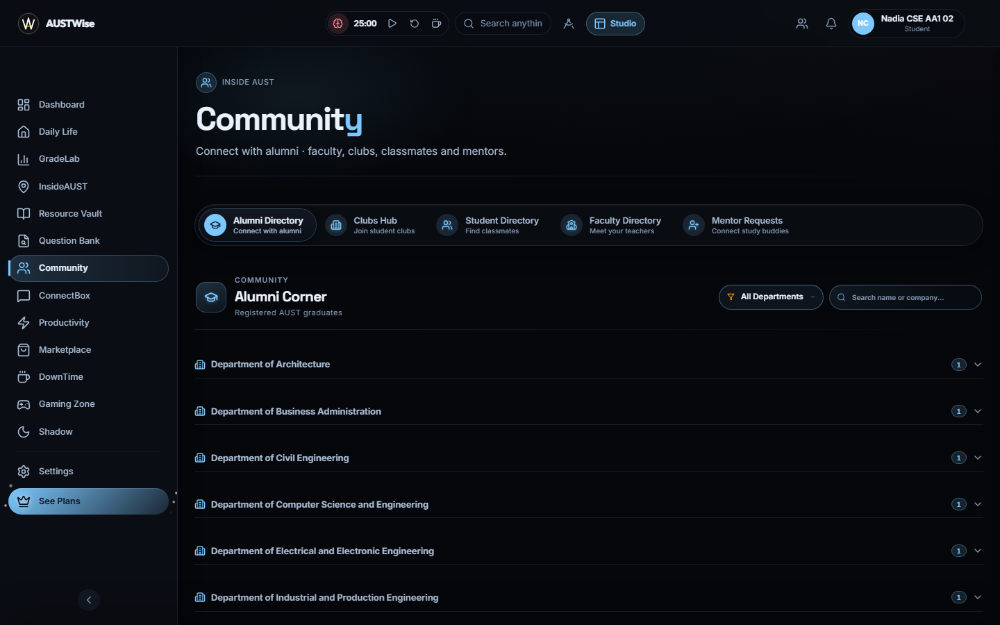<p align="center"><b>Community</b>: alumni, clubs, faculty, mentors</p></td>
    <td>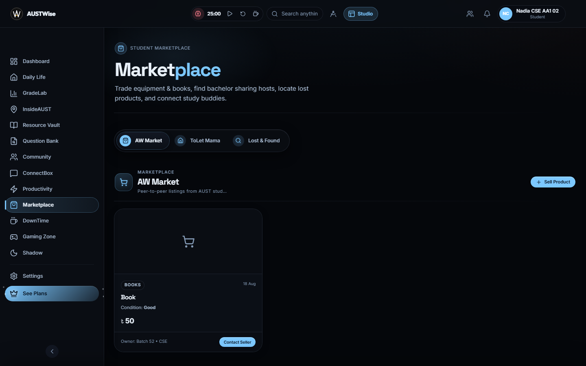<p align="center"><b>Marketplace</b>: buy, sell, rent, find</p></td>
  </tr>
  <tr>
    <td>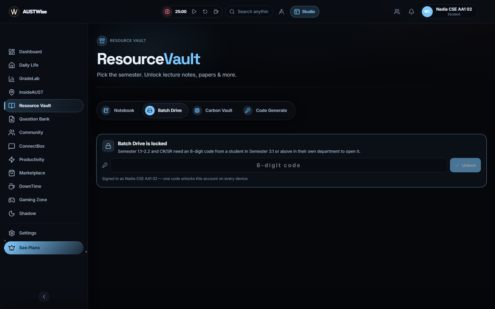<p align="center"><b>Resource Vault</b>: code-gated semester material</p></td>
    <td>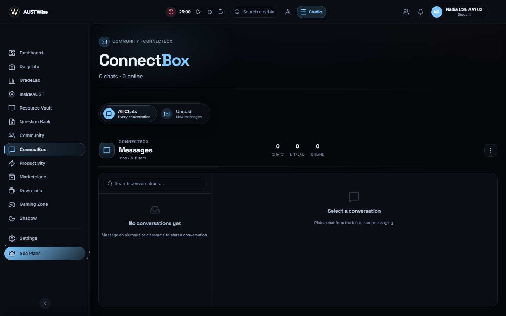<p align="center"><b>ConnectBox</b>: real-time messaging</p></td>
  </tr>
</table>

<p align="center">
  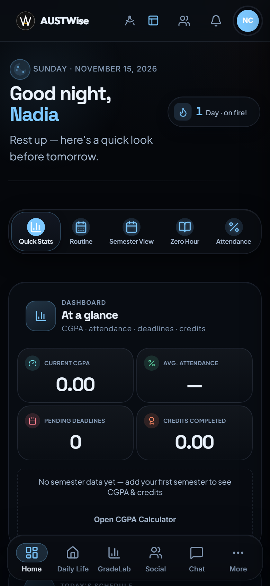
  &nbsp;&nbsp;
  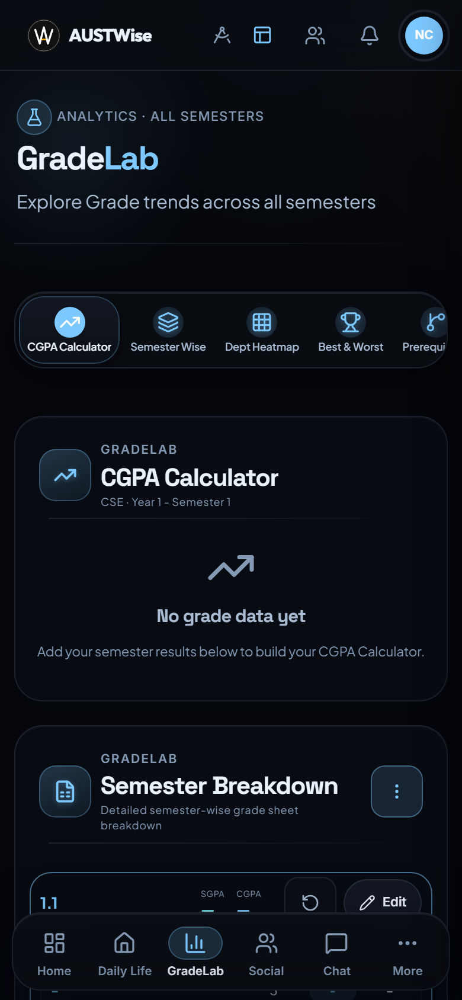
  <br />
  <sub>On phones the sidebar becomes a bottom tab bar, and tables and grids reflow into single-column cards.</sub>
</p>

---

## How it works

### 1. Sign in once, use it everywhere
Users register with their AUST identity (department, semester, section, lab group). Sign-in sets an **HttpOnly JWT cookie**, so the token is never reachable from JavaScript. Social sign-in is available through GitHub, Discord, Spotify, Facebook and Steam.

### 2. Local-first, synced to the cloud
Every feature writes to `localStorage` first, so the UI responds instantly and keeps working offline. A **live store** layer then syncs each user's keys to PostgreSQL (`UserStore`), and shared data such as marketplace posts and notices goes to `SharedStore`. Opening the app on another device pulls the same state back.

### 3. Real-time over WebSockets
The browser gets a short-lived **WS ticket** from `/api/ws-ticket` and opens one WebSocket connection. That single connection carries chat messages, typing and presence, active-member updates, gaming-room chat and event broadcasts.

### 4. AI-assisted tools
- **Routine extraction:** upload a photo of a timetable and the server sends it to OpenAI, then returns a structured weekly routine.
- **AI chat:** an authenticated server-side proxy to Google Gemini, which keeps the API key off the client.
- **Question Bank Analyzer:** builds a course-specific master prompt from your papers and syllabus. You can run it in your own AI tool for free, then paste the result back to get a ranked, trackable study plan.

### 5. Notifications
A Telegram bot sends class reminders and attendance prompts on a schedule (`telegramScheduler`), with message templates per event. Webhook updates are verified with a secret token.

### 6. Payments
Pro plans are paid through **SSLCommerz** or **PipraPay**, with success and cancel callbacks handled by the server.

---

## Architecture

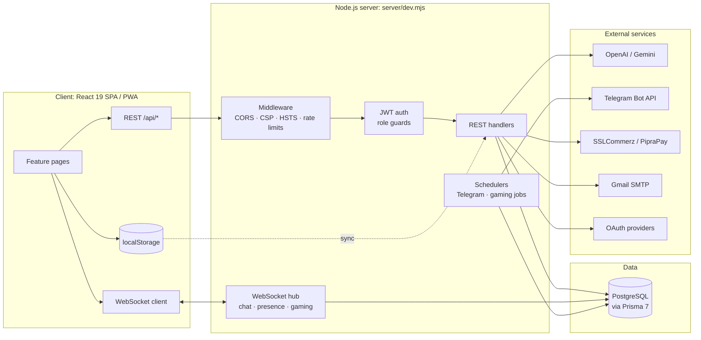

| Layer | Technology |
| --- | --- |
| **Frontend** | React 19, React Router 7, Vite 8, `vite-plugin-pwa`, Framer Motion, GSAP |
| **Charts and visuals** | Chart.js, D3, Leaflet (+ heatmap), Mermaid, Markmap, Three.js / React Three Fiber |
| **Documents** | jsPDF, html2canvas-pro, pdf.js, QR codes |
| **Backend** | Node.js ≥ 20, zero-framework HTTP server, `ws` WebSockets |
| **Database** | PostgreSQL with Prisma 7 (`@prisma/adapter-pg`), schema auto-applied on boot |
| **Auth and security** | bcrypt, JWT in HttpOnly cookies, AES-256-GCM vault encryption, role guards, rate limiting |
| **Integrations** | OpenAI, Gemini, Telegram Bot API, Gmail SMTP (Nodemailer), SSLCommerz, PipraPay, Google Drive / YouTube / Classroom |
| **Companion apps** | Electron desktop chat bubble (`desktop/`), native Android overlay bubble (`android-overlay/`) |
| **Quality** | Vitest unit and integration tests, ESLint 10 |

### Data model (Prisma)

The main models are `User`, `StudentDetails`, `Routine`, `SemesterResult`, `QuestionPaper`, `Course`, `MarketplaceListing`, `MentorRequest`, `Message`, `MessageReaction`, `Notice`, `CanteenMenuItem`, `LibraryCheckin`, `Club`, `ClubMembership`, `Invitation`, `RoleApplication`, `RoutineTemplate`, `SharedRoutine`, `TelegramUser`, `Cheatsheet`, `CampusLocation`, `UserStore` and `SharedStore`. The gaming models are `Game`, `GameRoom`, `GameRoomMember`, `GameRoomMessage`, `GamerProfile`, `GameEvent`, `EventEntry`, `TournamentMatch`, `GamingReport` and `GamingSanction`. See [`server/prisma/schema.prisma`](server/prisma/schema.prisma).

---

## Project structure

```text
AUSTWise/
├── src/
│   ├── App.jsx                 # Routes, auth guard, lazy-loaded pages
│   ├── context/                # Auth, Theme, Routine, Pomodoro providers
│   ├── layout/                 # Sidebar, top bar, mobile bottom nav, Studio layout
│   ├── features/               # One folder per product area
│   │   ├── dashboard/  analytics/  campus/  vault/  question-bank-analyzer/
│   │   ├── daily-life/ money-tracker/  community/  messages/  marketplace/
│   │   ├── productivity/  gaming/  shadow/  admin/  settings/  landing/ …
│   ├── data/                   # Courses, syllabus, campus and route data
│   └── utils/                  # Storage, sync, API and formatting helpers
├── server/
│   ├── dev.mjs                 # HTTP server: SPA + REST API + WebSocket upgrade
│   ├── auth.mjs  middleware.mjs  roleGuards.mjs  rateLimiter.mjs
│   ├── db.mjs  prisma/         # PostgreSQL access + Prisma schema
│   ├── wsServer.mjs            # Real-time hub
│   ├── gaming/                 # Gaming service, routes, realtime, tests
│   ├── telegram*.mjs           # Bot notifier and scheduler
│   ├── payment.mjs  socialOAuth.mjs  routineExtractor.mjs
│   └── *.json                  # Seed data (courses, locations, canteen, roles)
├── public/                     # Icons, PWA manifest, campus floor plans
├── desktop/                    # Electron always-on-top chat bubble
├── android-overlay/            # Android "display over other apps" chat bubble
├── scripts/                    # Dev runner, data generators, setup wizards
├── dev/                        # Demo-user seed data for local development
├── docs/                       # Feature docs, migration notes, screenshots
├── render.yaml  vercel.json    # Deployment blueprints
└── .env.example                # Every supported environment variable
```

---

## Getting started

### Prerequisites
- **Node.js 20+** and npm
- **PostgreSQL 14+** (local, Docker, or a hosted instance)

### Setup

```bash
git clone https://github.com/mubasshirahin/AUSTWise.git
cd AUSTWise
npm install                 # also runs `prisma generate`
cp .env.example .env        # then fill in the values below
npm run dev                 # Vite HMR + API server on http://localhost:5174
```

On first boot the server creates every table it needs, so no migration step is required. In development, `/api/dev/*` exposes seeded demo users (from `dev/devUsers.json`), which lets you try every role without registering.

### Environment variables

Only the first block is needed to run the app. Every integration is optional and switches itself off when its keys are missing. The full annotated list is in [`.env.example`](.env.example).

| Variable | Required | Purpose |
| --- | :---: | --- |
| `DATABASE_URL` | ✅ | PostgreSQL connection string (or the split `DB_SERVER` / `DB_PORT` / `DB_DATABASE` / `DB_USER` / `DB_PASSWORD`) |
| `JWT_SECRET` | ✅ | Signs auth tokens: `node -e "console.log(require('crypto').randomBytes(64).toString('hex'))"` |
| `CRYPTO_SECRET_KEY` | ✅ | AES-256-GCM key for the password vault |
| `ADMIN_DEFAULT_PASSWORD` | ✅ | Seeds the first admin (≥ 12 chars). Change it after first login. |
| `PORT` |  | Server port (default `5174`) |
| `PUBLIC_BASE_URL` |  | Public origin used for OAuth callbacks |
| `ALLOWED_ORIGIN` |  | Comma-separated CORS origins when frontend and API are on different hosts |
| `VITE_API_URL` / `VITE_WS_URL` |  | API and WebSocket endpoints for a split frontend deploy |
| `COOKIE_SECURE`, `ENABLE_HSTS`, `ENABLE_CSP` |  | Production hardening flags |
| `OPENAI_API_KEY`, `GEMINI_API_KEY` |  | Routine extraction from images (OpenAI) and AI chat (Gemini) |
| `TELEGRAM_BOT_TOKEN`, `TELEGRAM_WEBHOOK_SECRET` |  | Reminders and attendance bot |
| `GMAIL_USER`, `GMAIL_APP_PASSWORD` |  | Invite and password-reset email |
| `GITHUB_*`, `DISCORD_*`, `SPOTIFY_*`, `FACEBOOK_*`, `STEAM_API_KEY` |  | Social sign-in |
| `SSL_STORE_*`, `PIPRAPAY_*` |  | Pro-plan payments |
| `LIBRARY_LAT`, `LIBRARY_LNG`, `LIBRARY_RADIUS_M`, `LIBRARY_CAPACITY` |  | Library GPS check-in geofence |

### Scripts

| Command | Description |
| --- | --- |
| `npm run dev` | API server and Vite dev server with HMR |
| `npm run dev:vite` | Frontend only (proxies `/api` to a running server) |
| `npm run build` | Production build to `dist/` |
| `npm start` | Serve the built SPA, API and WebSocket from one process |
| `npm test` | Run the Vitest suite |
| `npm run lint` | ESLint over the whole project |

---

## Deployment

AUSTWise runs as **one Node process** that serves the built SPA, the REST API and the WebSocket upgrade. You can deploy it in either of two shapes:

**Single host (recommended).** Run `npm run build && npm start` behind any TLS-terminating proxy. [`render.yaml`](render.yaml) is a ready-made Render Blueprint that provisions PostgreSQL and the web service, and generates `JWT_SECRET` and `CRYPTO_SECRET_KEY` for you.

**Split frontend.** Deploy the static frontend to Vercel ([`vercel.json`](vercel.json)) and the API to Render. Set `VITE_API_URL`, `VITE_WS_URL` and `ALLOWED_ORIGIN` so the two can reach each other.

<details>
<summary><b>Self-hosting with nginx + PM2</b></summary>

```nginx
server {
    listen 443 ssl;
    server_name austwise.example.com;

    ssl_certificate     /etc/letsencrypt/live/austwise.example.com/fullchain.pem;
    ssl_certificate_key /etc/letsencrypt/live/austwise.example.com/privkey.pem;
    client_max_body_size 20M;

    location / {
        proxy_pass http://127.0.0.1:5174;
        proxy_set_header Host $host;
        proxy_set_header X-Forwarded-For $proxy_add_x_forwarded_for;
        proxy_set_header X-Forwarded-Proto $scheme;
        proxy_http_version 1.1;                       # WebSocket support
        proxy_set_header Upgrade $http_upgrade;
        proxy_set_header Connection "upgrade";
    }
}
```

```bash
npm ci && npm run build
npm i -g pm2
pm2 start server/dev.mjs --name austwise
pm2 save && pm2 startup
```

Then set `COOKIE_SECURE=1` and `ENABLE_HSTS=1`.
</details>

---

## Security

- **Passwords** are hashed with bcrypt. **Vault entries** are encrypted with AES-256-GCM before storage.
- **Sessions** use an `HttpOnly`, `SameSite=Lax` JWT cookie, plus `Secure` when `COOKIE_SECURE=1` is set.
- **Authorization** is enforced server-side by role guards on every protected route, never only in the UI.
- **Rate limiting** applies globally, with stricter buckets for auth and AI-extraction endpoints.
- **Inputs** go through parameterized queries only. CORS is same-origin unless `ALLOWED_ORIGIN` is set. CSP and HSTS can be switched on with environment flags.
- **Webhooks** are checked: Telegram updates without the secret token are rejected in production.
- **Dev endpoints** (`/api/dev/*`) are hard-disabled when `NODE_ENV=production`.

---

## Testing

```bash
npm test
```

There are 20 Vitest suites. They cover role guards and permissions, the gaming catalog, routes, chat safety and tournament brackets (including a full integration run), Question Bank question matching, and core storage helpers.

---

## Documentation

- [Dashboard Quick Stats: product guide](docs/features/dashboard-quick-stats.md) and [technical notes](docs/features/dashboard-quick-stats-technical.md)
- [Question Bank Analyzer](docs/features/question-bank-analyzer.md)
- [Database migration notes](docs/MIGRATION.md)
- [Desktop chat bubble](desktop/README.md) · [Android chat bubble](android-overlay/README.md)

---

<div align="center">

Built by **[Mubasshir Ahin](https://github.com/mubasshirahin)** for the students of AUST.

<sub>AUSTWise is an independent student project and is not officially affiliated with Ahsanullah University of Science & Technology.</sub>

</div>
